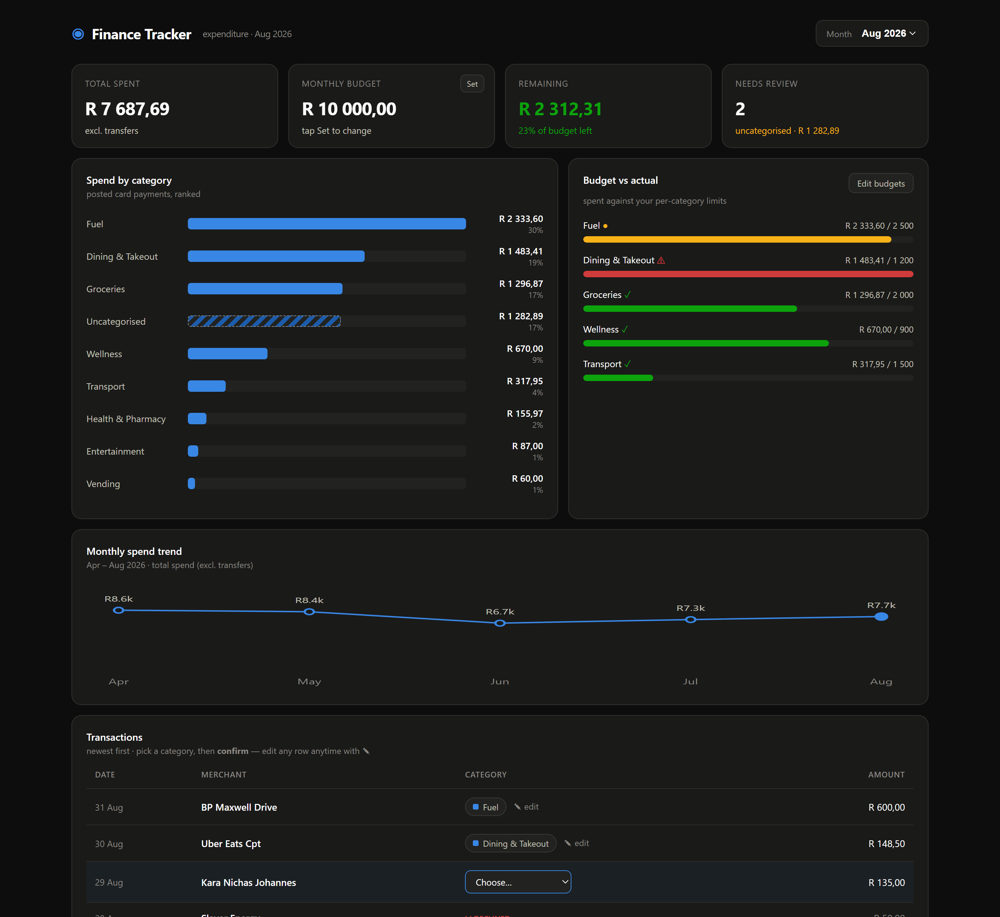

# Finance Tracker

**A self-hosted spending tracker that turns raw bank emails into a live, categorised view of where your money goes.**

It ingests Discovery Bank transaction emails straight from Gmail, parses and deduplicates them into PostgreSQL, learns how *you* categorise your spending, and serves it all through a fast React dashboard — budgets, trends, per-category drill-downs and a "needs review" queue.

Fully self-contained: its own database, its own ingest, its own schedule. **No coupling to any other project.**



---

## Why I built it

My spending was buried inside bank notification emails — unreadable, uncategorised, impossible to reason about. Budgeting apps either wanted bank login credentials or a subscription. So I built a pipeline that reads the emails I already get, structures them into a proper database, and puts a dashboard on top that actually learns my habits.

The interesting problem wasn't the UI — it was the **data**: parsing fragile bank-email formats reliably, deduplicating re-sent notifications, and building a categoriser that improves every time I correct it.

## What it does

- **Automatic ingest** — reads Discovery Bank emails from Gmail (read-only), parses amount / merchant / timestamp / type, and upserts into Postgres with an idempotent `dedup_key` so re-runs never double-count.
- **Self-learning categorisation** — every manual correction is remembered per-merchant and applied to all past and future transactions. Mixed merchants (e.g. a fuel station that also sells snacks) support a *"just this one"* vs *"remember this merchant"* choice.
- **Monthly dashboard** — total spend, monthly budget, remaining, and a "needs review" count of uncategorised transactions, all per selected month.
- **Budgets** — editable per-category limits plus an overall monthly budget, with budget-vs-actual bars (on track / warning / over).
- **Spend analysis** — ranked spend-by-category, a month-over-month trend line, and per-category drill-downs.
- **Transfers & notes** — internal vs external transfers are classified out of spend totals, with free-text notes.
- **Manual edits stick** — a `category_locked` flag protects anything you've set by hand from being overwritten on the next ingest.

## Architecture

```
Discovery Bank emails (Gmail)
        │   Python ingest  — parse · dedup · categorise
        ▼
   PostgreSQL  (finance_tracking)
        │   Node + Express API  :4000   — reads, computes, PATCH edits
        ▼
   React + Vite + Tailwind  :5173   — live dashboard
```

A deliberately decoupled "house": the Python ingest owns a **vendored copy** of the bank-email parser (`ingest/banking.py`) rather than importing it from anywhere else — duplication is fine, coupling is not.

## Tech stack

| Layer | Tech | Notes |
| --- | --- | --- |
| Ingest | **Python** | Gmail API (read-only), bank-email parser, idempotent upsert |
| Database | **PostgreSQL 18** | `NUMERIC` money, `TIMESTAMPTZ`, `dedup_key UNIQUE` |
| API | **Node.js + Express + pg** | JSON endpoints + `PATCH` for category/budget edits |
| Dashboard | **React + Vite + Tailwind** | live SPA — month view, budgets, trends, drill-downs |
| Schedule | **cron** | incremental ingest, independent of everything else |

## Data model

`txn` (transactions, with `category_locked`) · `category` · `merchant_rule` (seed categorisation) · `merchant_category` (learned overrides) · `budget` (per-category + default) · `app_setting` (monthly budget).

## Layout

```
db/        schema.sql · seed.sql · categorise.sql     Postgres foundation
ingest/    ingest.py · banking.py · gmail_client.py   Gmail → Postgres
api/       Express + pg JSON API                       (port 4000)
frontend/  React + Vite + Tailwind dashboard           (port 5173)
```

## Setup

```bash
cp .env.example .env            # fill in FINANCE_PGPASSWORD (+ Gmail creds)
psql -f db/schema.sql -f db/seed.sql   # (once) tables + category/merchant rules
```

Secrets — `.env` and `ingest/token.json` — are git-ignored and never committed.

## Run

```bash
# ingest (Python) — incremental is what cron runs; --backfill for catch-up
python ingest/ingest.py
python ingest/ingest.py --backfill --max 300

# API (Node, port 4000)
cd api && npm install && npm start        # loads ../.env via --env-file

# dashboard (React + Vite, port 5173 — proxies /api to :4000)
cd frontend && npm install && npm run dev
```

## Privacy

Gmail access is **read-only** (`gmail.readonly`). Mail never leaves your machine — it is parsed locally into your own Postgres. All credentials live in a git-ignored `.env` / `token.json`.
